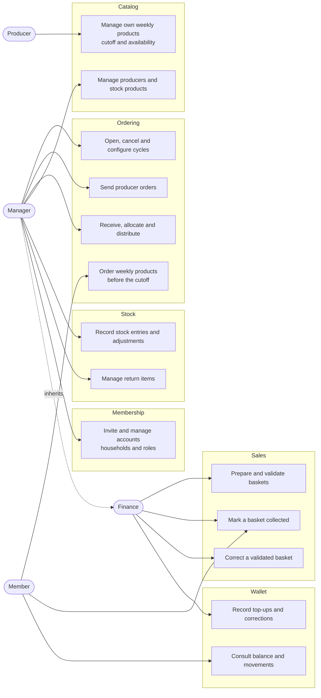
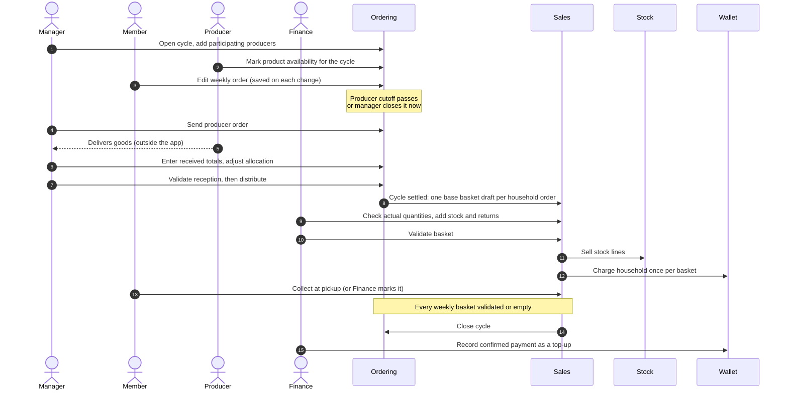
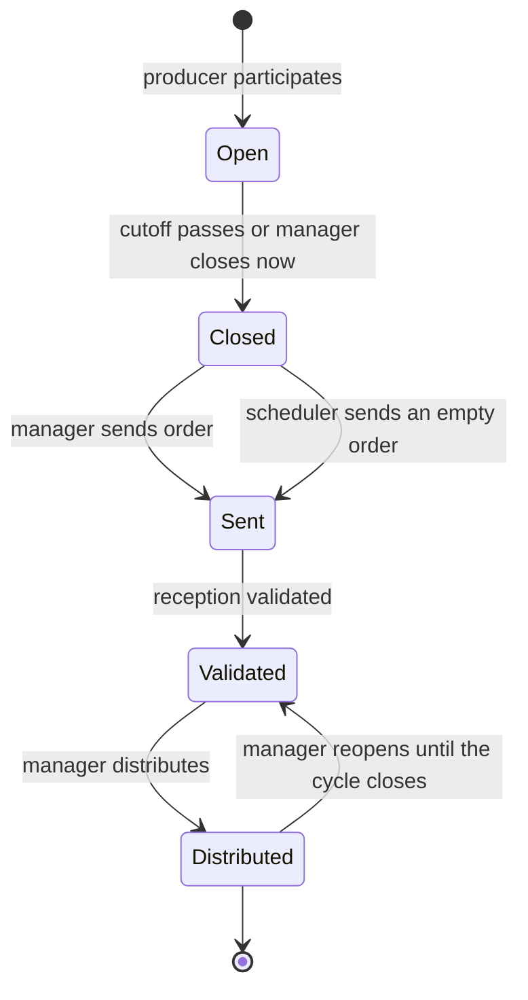
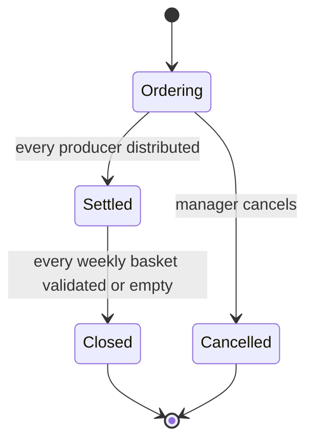
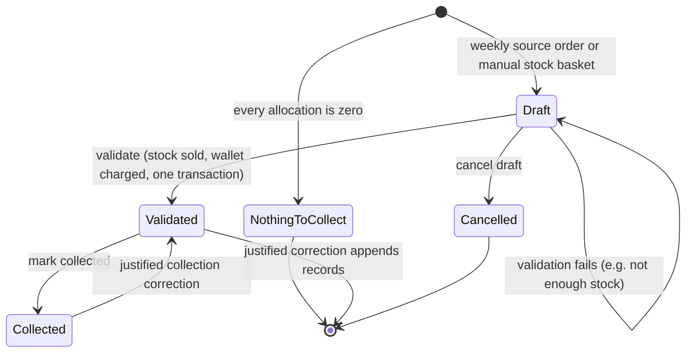
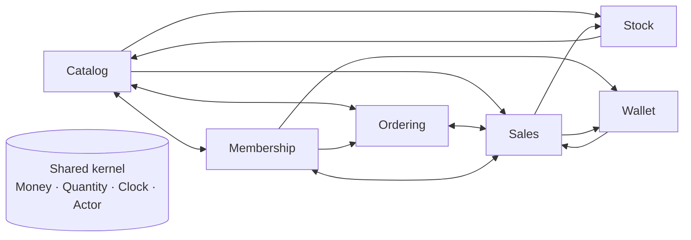
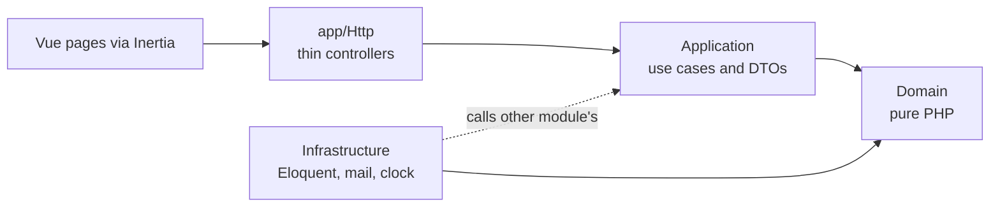
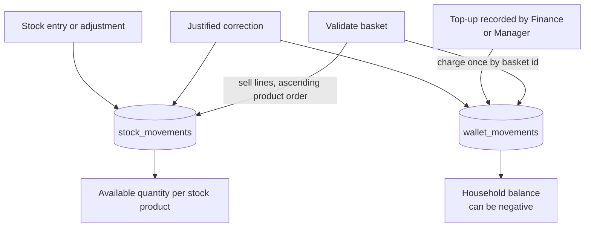

# Project overview

A visual map of Guixa for reading use cases and spotting steps to improve. It summarises the current
implementation of feature [001 — Weekly orders](../specs/001-weekly-orders/spec.md); where this page
and a spec or [module contract](architecture/modules.md) disagree, they win.

Sources: `routes/web.php`, `src/*/Domain` enums and aggregates, `architecture/modules.php`, the 001 spec
areas and the [UX discovery](ux-discovery/2026-10-24-guixa-discovery.md). The
[001 diagrams](../specs/001-weekly-orders/diagrams.md) go deeper on the data model.

## 1. Who does what

Four roles. _Member_ is never stored: an account is a member exactly when it is linked to a household.
A manager keeps every Finance power. Finance gets baskets and receipts only.

## 2. One cycle, end to end

The weekly rhythm. The cooperative has about 10 managers sharing the work, so every step may be done by
a different person. The left side is Ordering; from the base basket on, Sales owns the money.

## 3. States

### Producer order inside a cycle

Each participating producer moves on its own. A cycle is _settled_ when every one is distributed.

### Cycle

Closed is reached after validation, not collection. A closed cycle can still have baskets waiting to be
picked up, and those keep showing as pending.

### Basket

Weekly baskets start as drafts built from the order. Stock baskets are created by hand, at any time,
with no cycle.

## 4. Modules and who calls whom

A modular monolith. Arrows are the integration exports in
[`modules.md`](architecture/modules.md); each is a port in the caller and an adapter in its
Infrastructure.

Inside every module the dependency points inwards:

## 5. Money and stock

Sales is the only writer of weekly money. Wallet and Stock are append-only ledgers, and a correction
adds a record instead of editing one.

## 6. Candidates to improve

Each point comes from something visible in the code or the specs. They are prompts for a decision, not
agreed work. Check the spec before acting on one.

| #   | Observation                                                                                                                                                                      | Evidence                                                                                     | Possible step                                                                                           |
| --- | -------------------------------------------------------------------------------------------------------------------------------------------------------------------------------- | -------------------------------------------------------------------------------------------- | ------------------------------------------------------------------------------------------------------- |
| 1   | No "what do I do now" view. The dashboard spec was retired, yet managers work in short, infrequent sessions and forget rare tasks.                                               | [Spec 002](../specs/002-actionable-dashboard/spec.md) retired; UX discovery, Manager persona | Reopen the dashboard decision once 001 is complete, starting from the attention list                    |
| 2   | A cycle has about six manual manager steps per producer (send, receive, validate, distribute, plus reopen when wrong). With about 7 producers a week this is the heaviest load.  | Producer order diagram; routes under `manage/cycles/{cycle}/receptions/{producer}`           | Measure time per step before automating. Bulk "send all ready" is the cheapest candidate                |
| 3   | No notifications except sending the order to a producer. Members and producers learn about cutoffs and pickups outside the app.                                                  | Roadmap: Notifications; spec R12a                                                            | Cutoff and pickup reminders, the first notification feature                                             |
| 4   | A producer cannot confirm or adjust a sent order. Gaps surface only at reception.                                                                                                | Roadmap: Producer confirmation                                                               | Add `Confirmed` between `Sent` and `Validated`                                                          |
| 5   | Payment is a separate manual top-up, not tied to a basket, and validation does not wait for it. Reconciling who paid for what is manual.                                         | Money section; spec stock-wallet                                                             | Per-household "owes" list from the negative balances                                                    |
| 6   | Wallet top-ups and corrections lived twice, under `manage/households/{household}/wallet` and `finance/households/{household}/wallet`; T72 (DRA-234) kept only the Finance route. | `routes/web.php`                                                                             | Done in T72: one set serves both roles                                                                  |
| 7   | Catalog↔Ordering and Ordering↔Sales depend on each other. This is intentional and tested, but it is the likeliest place for a cycle in the constructors to appear.               | [Module contracts](architecture/modules.md), reciprocal dependencies                         | Keep reads narrow, as the contract says. Watch new exports in review                                    |
| 8   | The `Manager` to `Admin` rename is queued before Commissions and touches specs, code and screens.                                                                                | Roadmap: Admin rename, Commissions                                                           | Do it as one mechanical change before any new permission work                                           |
| 9   | Producer invoicing, the monthly amount payable and container returns to producers are all missing, so the cooperative tracks what it owes producers elsewhere.                   | Roadmap                                                                                      | Start with the monthly report. Its open question is the basis, validated reception or distributed goods |

## 7. Where to read next

| To know                         | Read                                                                               |
| ------------------------------- | ---------------------------------------------------------------------------------- |
| Rules and acceptance scenarios  | [`specs/001-weekly-orders`](../specs/001-weekly-orders/spec.md) and its area files |
| Architecture rules A1–A17       | [Constitution](../specs/constitution.md)                                           |
| Module exports and table owners | [Module contracts](architecture/modules.md)                                        |
| Data model                      | [001 diagrams](../specs/001-weekly-orders/diagrams.md)                             |
| What is next                    | [Roadmap](../specs/README.md#roadmap)                                              |
