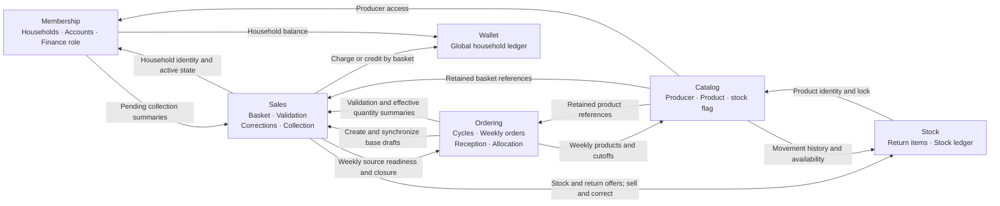
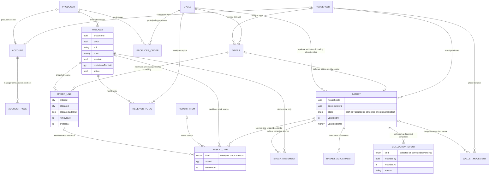
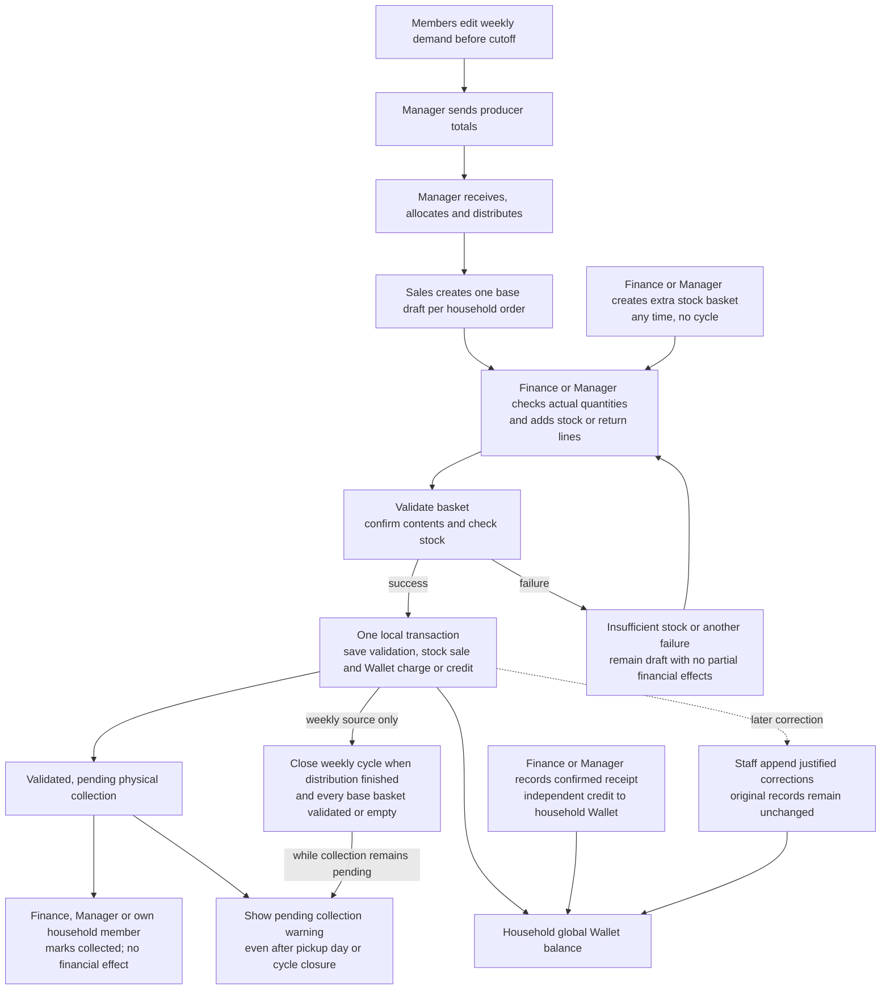

# 001 — Weekly orders · Diagrams

Revised (2026-10-28). Derived from [plan.md](plan.md) and the [specification areas](spec.md#areas);
their written rules take precedence.

## 1. Contexts and interfaces

Each arrow is a caller-owned port with an Infrastructure adapter calling the other context's
Application interface. Models/DTOs are translated there. All contexts remain in the same application;
validation and linked stock/Wallet corrections share one local transaction.

## 2. Model relations

A source order is required only for the automatic weekly base. A stock-only basket can have neither
order nor cycle.
Member is derived from the household link, not stored in ACCOUNT_ROLE. Removed/cancelled source
records remain for first-use evidence; no separate used-product marker is added.

## 3. Weekly and independent sales

Receipts independently affect the household balance; they are not allocated to a basket and are
not a prerequisite to validation/collection. Empty-source baskets need no collection;
zero-price goods and net-zero real-content baskets still follow the confirmed validation rules.
