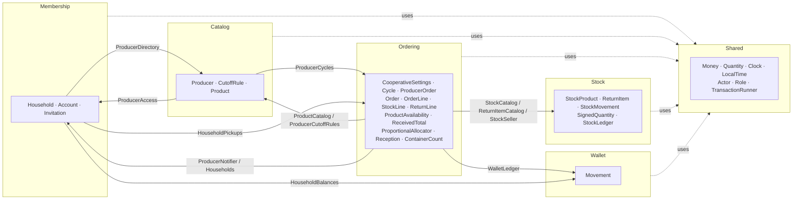
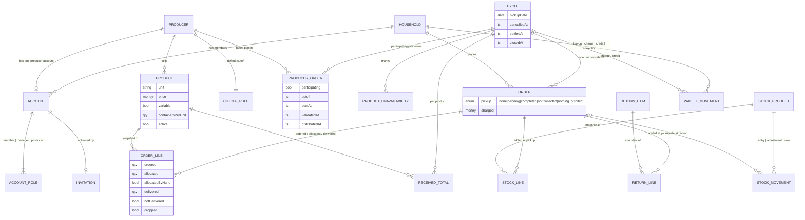
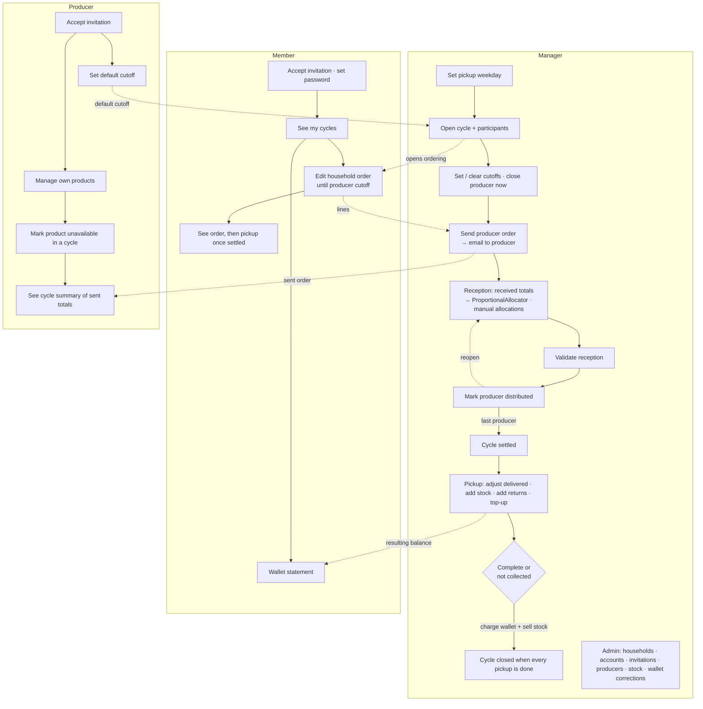

# 001 — Weekly orders · Diagrams

Derived from [plan.md](plan.md) and the [areas](spec.md#areas); when they disagree, those documents win.

## 1. Domains (bounded contexts and ports)

## 2. Model relations

## 3. User paths

